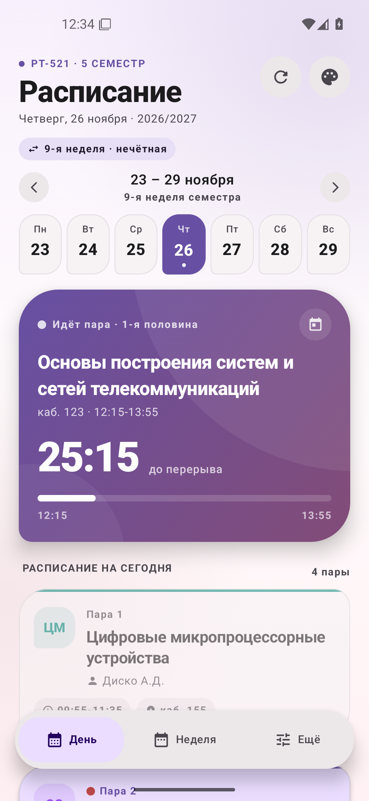
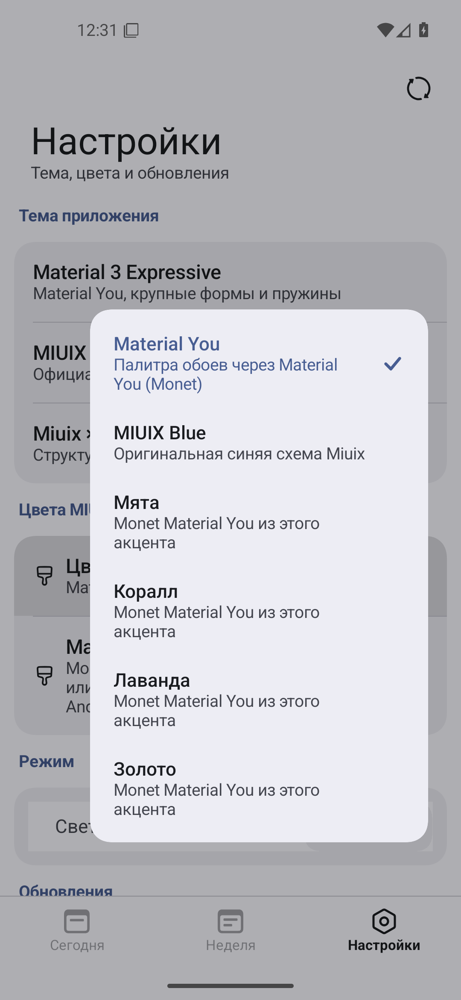

# RT-521 · Расписание

Нативное Android-приложение для расписания группы **РТ-521** (5 семестр, 2026/2027).
Kotlin, Jetpack Compose, официальная библиотека
[**Compose Miuix**](https://github.com/compose-miuix-ui/miuix) и Material 3 Expressive.

Приложение не содержит входа, кодов и админки: это не сайт, а читалка расписания.
Актуальные данные лежат в [`data/schedule.json`](data/schedule.json) этого репозитория.

**APK:** собирается в GitHub Actions и прикладывается к [Releases](https://github.com/OWNER/rt521-schedule/releases)
· Android 8+ · `applicationId app.rt521.schedule`

## Темы

| Material 3 Expressive | MIUIX · Material You (Monet) | MIUIX · Blue | Miuix × Expressive |
|---|---|---|---|
|  |  |  |  |

<table><tr>
<td></td>
<td></td>
</tr></table>

* **Material 3 Expressive** — HCT-палитры, крупная типографика, expressive-формы, пружинная
  анимация, живой прогресс пары.
* **MIUIX** — построена на **настоящей библиотеке Compose Miuix**: `Scaffold`, `TopAppBar`,
  `NavigationBar`, `Card`, `BasicComponent`, `TabRow`, `SwitchPreference`,
  `RadioButtonPreference`, `OverlayDialog`, иконки Miuix. Цвета — **Material You (Monet)**
  через `ThemeController`: палитра из обоев/акцента, плюс оригинальная синяя схема Miuix.
* **Miuix × Expressive** — гибрид: структура MIUIX и пластика Material 3.

Все темы: светлая, тёмная, системная. Monet использует `ThemeColorSpec.Spec2025` и
`ThemePaletteStyle.Expressive`, то есть настоящие Material You-цвета, которые генерирует Miuix.

## Обновления расписания из GitHub

`data/schedule.json` — единственный источник правды. Приложение:

* загружает JSON при запуске;
* обновляется автоматически **в 18:00 и 20:30** по местному времени — в фоне через WorkManager
  и сразу в интерфейсе, если приложение открыто;
* при запуске и возврате в приложение проверяет, не устарел ли кэш;
* обновляется по кнопке **⟳** на главном экране и в настройках;
* кэширует последнюю версию и работает офлайн;
* при ошибке сети показывает сохранённое расписание и предупреждение.

По умолчанию в сборке стоит заглушка
`https://raw.githubusercontent.com/OWNER/rt521-schedule/main/data/schedule.json`.
Укажите свой репозиторий одним из способов:

1. В приложении: **Настройки → Обновления → Источник расписания**.
2. В `gradle.properties` для локальной сборки:
   ```properties
   RT521_SCHEDULE_URL=https://raw.githubusercontent.com/<USER>/rt521-schedule/main/data/schedule.json
   ```

В GitHub Actions URL подставляется автоматически из `github.repository`, поэтому для CI
ничего менять не нужно — собранный там APK уже смотрит в ваш `data/schedule.json`.

GitHub отдаёт файл по HTTPS, поэтому в release ничего дополнительно настраивать не нужно.

## Формат JSON

Полная схема: [data/schedule.schema.json](data/schedule.schema.json).
Проверка: `python3 scripts/validate_schedule.py data/schedule.json`.

### Обычная пара

```json
{
  "time": "14:10-15:50",
  "subject": "Теория электрической связи",
  "room": "206",
  "teachers": ["Ковальчук К.Е."],
  "weeks": "all"
}
```

`weeks` может быть `"all"`, `[1, 3]` или `[2, 4]`.

### Замена, отмена или дополнительная пара

```json
"changes": [
  {
    "date": "2026-12-02",
    "kind": "replace",
    "time": "12:15-13:55",
    "subject": "Практикум по телекоммуникациям",
    "room": "123",
    "teachers": ["Колосовская Е.А."],
    "note": "Практика вместо лекции"
  },
  {
    "date": "2026-12-02",
    "kind": "cancel",
    "time": "16:20-18:00",
    "note": "Пара отменена"
  },
  {
    "date": "2026-12-03",
    "kind": "extra",
    "time": "18:15-19:55",
    "subject": "Консультация",
    "room": "205"
  }
]
```

* `replace` — убрать базовую пару на это время и показать новую;
* `cancel` — пометить пару отменённой;
* `extra` — добавить пару поверх расписания.

### Работа

```json
"works": [
  {
    "date": "2026-12-04",
    "subject": "Теория электрической связи",
    "type": "Контрольная работа",
    "title": "Спектры сигналов",
    "note": "Повторить модуляцию"
  }
]
```

Работа появится в карточке предмета за 7 дней и в день работы, а также в обзоре недели.

После правки JSON GitHub Actions проверит файл. Приложение подхватит изменения в ближайшее
время обновления или по кнопке.

## Сборка

Нужны JDK 17 и Android SDK **37** (`platforms;android-37.0`, `build-tools;37.0.0`).
compileSdk 37 требуется библиотекой Miuix; targetSdk — 36, minSdk — 26.

```bash
./gradlew testDebugUnitTest lintDebug assembleDebug
./gradlew assembleRelease
```

APK: `app/build/outputs/apk/debug/app-debug.apk` или
`app/build/outputs/apk/release/app-release.apk`.

### Подпись release

`app/build.gradle.kts` читает `keystore.properties` (в `.gitignore`):

```properties
storeFile=/absolute/path/to/rt521-release.jks
storePassword=...
keyAlias=...
keyPassword=...
```

Для GitHub Releases добавьте secrets:

* `KEYSTORE_BASE64` — `base64 -w0 rt521-release.jks`;
* `KEYSTORE_PASSWORD`;
* `KEY_ALIAS`;
* `KEY_PASSWORD`.

Workflow [`.github/workflows/release.yml`](.github/workflows/release.yml) собирает и прикладывает
подписанный APK к релизу по тегу `v*`.

## Загрузка на GitHub

Репозиторий уже инициализирован локально. Создайте на GitHub пустой репозиторий
`rt521-schedule` (без README) и выполните:

```bash
git remote add origin git@github.com:<USER>/rt521-schedule.git
git branch -M main
git push -u origin main
```

Затем замените `OWNER` в `gradle.properties` на свой ник (или укажите URL в приложении).
GitHub Actions соберёт debug APK во вкладке **Actions**. Для релиза:

```bash
git tag v2.0.0
git push origin v2.0.0
```

Подробнее: [CONTRIBUTING.md](CONTRIBUTING.md).

## Структура

```
data/schedule.json          расписание, замены, работы — правится в GitHub
data/schedule.schema.json   JSON-схема
scripts/validate_schedule.py проверка перед публикацией
app/src/main/java/app/rt521/schedule/
├── data/                   парсер JSON, AppState, кэш и автообновление
├── ui/theme/               Material 3 Expressive + MIUIX (Miuix) + Hybrid
├── ui/miuix/               экраны на официальных Miuix-компонентах
├── ui/screens/             Material/Hybrid экраны
└── ui/components/          общие компоненты
.github/workflows/          CI, release, проверка JSON
```

## Лицензия

Код приложения — MIT. Miuix — Apache-2.0.
См. [LICENSE](LICENSE) и [THIRD_PARTY_NOTICES.md](THIRD_PARTY_NOTICES.md).
