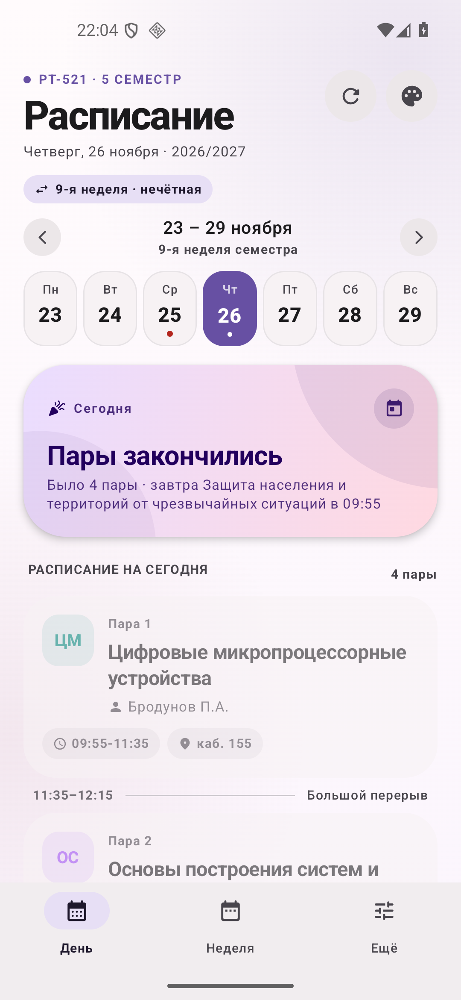
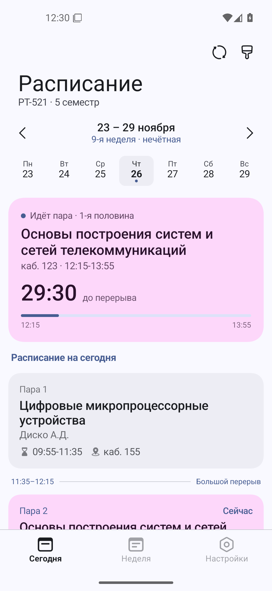
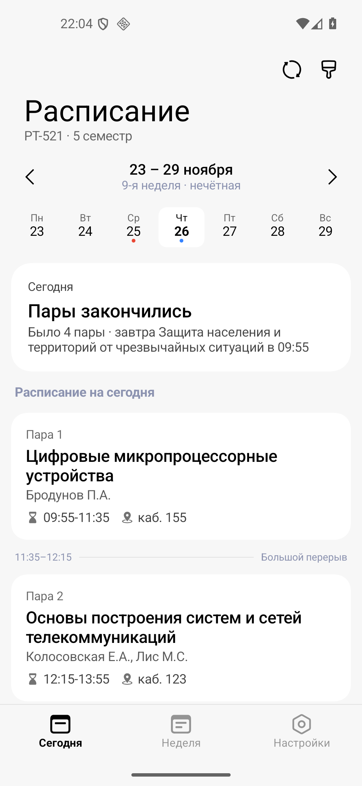
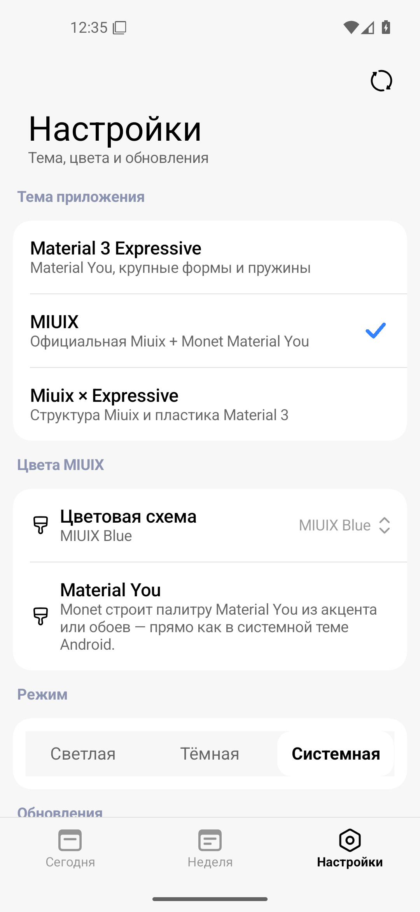
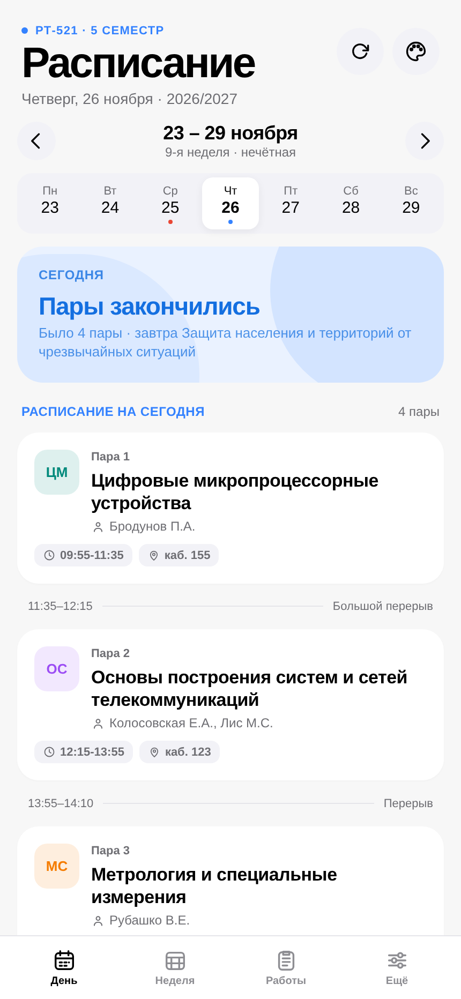
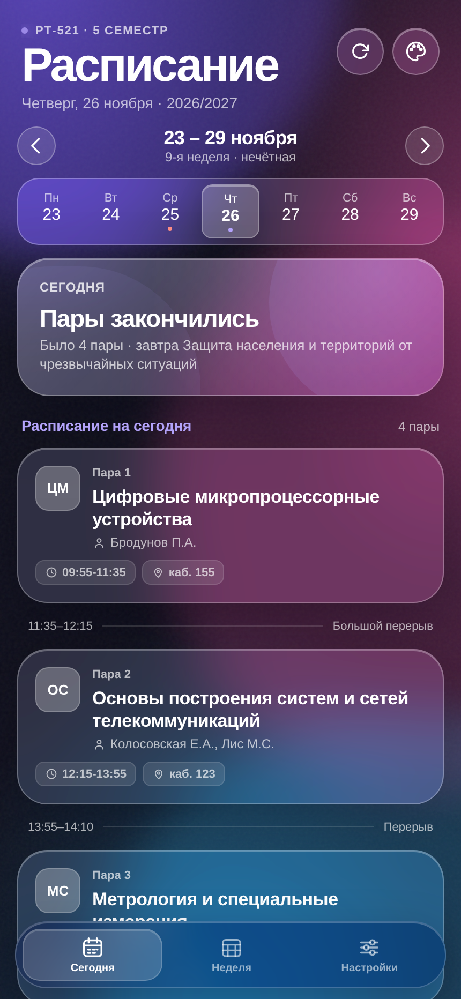

# RT-521 · Расписание

Расписание группы **РТ-521** (5 семестр, 2026/2027): нативное Android-приложение
и устанавливаемая веб-версия (PWA).

* **Android** — Kotlin, Jetpack Compose, официальная библиотека
  [**Compose Miuix**](https://github.com/compose-miuix-ui/miuix), Material 3 Expressive,
  три размера домашних виджетов.
* **Web** — PWA с темами **MIUIX** и **iOS Liquid Glass**, устанавливается на iPhone через
  «Поделиться → На экран Домой» и на Android из браузера.

Ни в приложении, ни на сайте нет входа, кодов и админки: это читалка расписания.
Актуальные данные лежат в [`data/schedule.json`](data/schedule.json) этого репозитория.

**Android APK:** [Releases](https://github.com/MrFikus13/rt521-schedule/releases)
· Android 8+ · `applicationId app.rt521.schedule`

**PWA:** <https://mrfikus13.github.io/rt521-schedule/>

## Темы

| Material 3 Expressive | MIUIX · Material You (Monet) | MIUIX · Blue | Miuix × Expressive |
|---|---|---|---|
|  |  |  |  |

<table><tr>
<td></td>
<td></td>
</tr></table>

* **Material 3 Expressive** — HCT-палитры, крупная типографика, expressive-формы, пружинная
  анимация, живой прогресс пары.
* **MIUIX** — построена на **настоящей библиотеке Compose Miuix**: `Scaffold`, `TopAppBar`,
  `NavigationBar`, `Card`, `BasicComponent`, `TabRow`, `SwitchPreference`,
  `RadioButtonPreference`, `OverlayDialog`, иконки Miuix. Цвета — **Material You (Monet)**
  через `ThemeController`: палитра из обоев/акцента, плюс оригинальная синяя схема Miuix.
* **Miuix × Expressive** — гибрид: структура MIUIX и пластика Material 3.

Все темы: светлая, тёмная, системная. Monet использует `ThemeColorSpec.Spec2025` и
`ThemePaletteStyle.Expressive`, то есть настоящие Material You-цвета, которые генерирует Miuix.

## Виджеты Android

В приложении три домашних виджета — они добавляются долгим нажатием на рабочем столе →
**Виджеты → Расписание РТ-521**:

| Виджет | Размер | Что показывает |
|---|---|---|
| Маленький | 2×2 | текущая/следующая пара и обратный отсчёт |
| Средний | 4×2 | две ближайшие пары с временем и кабинетом |
| Большой | 4×4 | весь день, замены и работы |

Виджеты обновляются вместе с приложением: при запуске, по кнопке **⟳**, в 18:00 и 20:30
через WorkManager и системный `updatePeriodMillis`.

## Веб-версия (PWA)

Статическая версия живёт в [`web/`](web) и публикуется на GitHub Pages workflow
[`.github/workflows/pages.yml`](.github/workflows/pages.yml) при изменениях `web/**`
или `data/schedule.json`.

| MIUIX | iOS Liquid Glass |
|---|---|
|  |  |

* **MIUIX** — светлая/тёмная, крупная типографика, карточки и нижняя навигация в стиле Miuix.
* **iOS Liquid Glass** — доступна только в веб-версии: полупрозрачные слои, blur,
  «стеклянная» нижняя панель, живые градиенты. На Android-приложение не влияет.

PWA умеет работать офлайн (service worker + `localStorage`), обновляет данные в 18:00 и 20:30,
по кнопке и при возврате на вкладку. Тема и режим переключаются в **Настройки** и сохраняются.

### Установка на iPhone

1. Откройте <https://mrfikus13.github.io/rt521-schedule/> в **Safari**.
2. Нажмите **Поделиться** → **На экран «Домой»** → **Добавить**.
3. Запускайте расписание с иконки — оно откроется без адресной строки, в полноэкранном режиме.

На Android PWA устанавливается из Chrome через баннер «Установить приложение» или меню
⋮ → **Установить приложение**.

### Локальный запуск

```bash
scripts/build_web.sh          # копирует data/schedule.json в web/data/
cd web && python3 -m http.server 8080
# http://localhost:8080/?theme=liquid&mode=dark
```

## Обновления расписания из GitHub

`data/schedule.json` — единственный источник правды. Приложение:

* загружает JSON при запуске;
* обновляется автоматически **в 18:00 и 20:30** по местному времени — в фоне через WorkManager
  и сразу в интерфейсе, если приложение открыто;
* при запуске и возврате в приложение проверяет, не устарел ли кэш;
* обновляется по кнопке **⟳** на главном экране и в настройках;
* кэширует последнюю версию и работает офлайн;
* при ошибке сети показывает сохранённое расписание и предупреждение.

По умолчанию сборка смотрит в
`https://raw.githubusercontent.com/MrFikus13/rt521-schedule/main/data/schedule.json`.
URL можно изменить:

1. В приложении: **Настройки → Обновления → Источник расписания**.
2. В `gradle.properties` для локальной сборки:
   ```properties
   RT521_SCHEDULE_URL=https://raw.githubusercontent.com/<USER>/rt521-schedule/main/data/schedule.json
   ```

В GitHub Actions URL подставляется автоматически из `github.repository`, поэтому для форков
ничего менять не нужно — собранный там APK уже смотрит в ваш `data/schedule.json`.

GitHub отдаёт файл по HTTPS, поэтому в release ничего дополнительно настраивать не нужно.

## Формат JSON

Полная схема: [data/schedule.schema.json](data/schedule.schema.json).
Проверка: `python3 scripts/validate_schedule.py data/schedule.json`.

### Обычная пара

```json
{
  "time": "14:10-15:50",
  "subject": "Теория электрической связи",
  "room": "206",
  "teachers": ["Ковальчук К.Е."],
  "weeks": "all"
}
```

`weeks` может быть `"all"`, `[1, 3]` или `[2, 4]`.

### Замена, отмена или дополнительная пара

```json
"changes": [
  {
    "date": "2026-12-02",
    "kind": "replace",
    "time": "12:15-13:55",
    "subject": "Практикум по телекоммуникациям",
    "room": "123",
    "teachers": ["Колосовская Е.А."],
    "note": "Практика вместо лекции"
  },
  {
    "date": "2026-12-02",
    "kind": "cancel",
    "time": "16:20-18:00",
    "note": "Пара отменена"
  },
  {
    "date": "2026-12-03",
    "kind": "extra",
    "time": "18:15-19:55",
    "subject": "Консультация",
    "room": "205"
  },
  {
    "date": "2026-12-01",
    "kind": "note",
    "time": "12:15-13:55",
    "note": "Только 1 группа"
  }
]
```

* `replace` — убрать базовую пару на это время и показать новую;
* `cancel` — пометить пару отменённой;
* `extra` — добавить пару поверх расписания;
* `note` — примечание к существующей паре (например, «только 1 группа») без изменения
  предмета и преподавателя. Если пара на это время не найдена, примечание показывается
  отдельной карточкой.

### Работа

```json
"works": [
  {
    "date": "2026-12-04",
    "subject": "Теория электрической связи",
    "type": "Контрольная работа",
    "title": "Спектры сигналов",
    "note": "Повторить модуляцию"
  }
]
```

Работа появляется плашкой в карточке предмета только за 7 дней до сдачи и в день работы.
Если до работы больше недели, на карточке предмета горит оранжевая точка: нажмите на карточку,
чтобы раскрыть информацию о будущей работе. Отсчёт «через N дней» считается от выбранного
дня, поэтому при листании расписания вперёд он уменьшается.

В нижней панели есть отдельная вкладка **«Работы»** со всеми работами: ближайшими и прошедшими.
В воскресенье на экране дня дополнительно показываются все работы и заметки на следующую неделю.

После правки JSON GitHub Actions проверит файл. Приложение подхватит изменения в ближайшее
время обновления или по кнопке.

## Сборка

Нужны JDK 17 и Android SDK **37** (`platforms;android-37.0`, `build-tools;37.0.0`).
compileSdk 37 требуется библиотекой Miuix; targetSdk — 36, minSdk — 26.

```bash
./gradlew testDebugUnitTest lintDebug assembleDebug
./gradlew assembleRelease
```

APK: `app/build/outputs/apk/debug/app-debug.apk` или
`app/build/outputs/apk/release/app-release.apk`.

### Подпись release

`app/build.gradle.kts` читает `keystore.properties` (в `.gitignore`):

```properties
storeFile=/absolute/path/to/rt521-release.jks
storePassword=...
keyAlias=...
keyPassword=...
```

Для GitHub Releases добавьте secrets:

* `KEYSTORE_BASE64` — `base64 -w0 rt521-release.jks`;
* `KEYSTORE_PASSWORD`;
* `KEY_ALIAS`;
* `KEY_PASSWORD`.

Workflow [`.github/workflows/release.yml`](.github/workflows/release.yml) собирает и прикладывает
подписанный APK к релизу по тегу `v*`.

## Публикация

Репозиторий: <https://github.com/MrFikus13/rt521-schedule>.
Ветка `main` пушится обычным `git push`; workflow **Android CI** собирает debug APK,
**Validate schedule** проверяет JSON, а **Deploy PWA to GitHub Pages** публикует `web/`.

GitHub Pages включён в настройках репозитория (**Settings → Pages → Source: GitHub Actions**).
Сайт обновляется автоматически после каждого пуша в `main`.

Для релиза:

```bash
git tag v2.2.1
git push origin v2.2.1
```

Подробнее: [CONTRIBUTING.md](CONTRIBUTING.md).

## Структура

```
data/schedule.json          расписание, замены, работы — правится в GitHub
data/schedule.schema.json   JSON-схема
scripts/validate_schedule.py проверка перед публикацией
scripts/build_web.sh        копирует JSON в web/data/
web/                        PWA: MIUIX + iOS Liquid Glass
app/src/main/java/app/rt521/schedule/
├── data/                   парсер JSON, AppState, кэш и автообновление
├── widget/                 три домашних виджета и их обновление
├── ui/theme/               Material 3 Expressive + MIUIX (Miuix) + Hybrid
├── ui/miuix/               экраны на официальных Miuix-компонентах
├── ui/screens/             Material/Hybrid экраны
└── ui/components/          общие компоненты
.github/workflows/          CI, release, проверка JSON, GitHub Pages
```

## Лицензия

Код приложения — MIT. Miuix — Apache-2.0.
См. [LICENSE](LICENSE) и [THIRD_PARTY_NOTICES.md](THIRD_PARTY_NOTICES.md).
